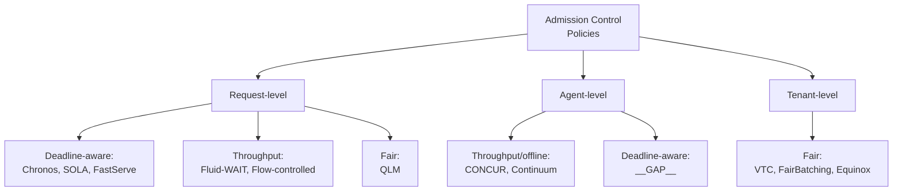

# Taxonomy — Admission Control for LLM Serving

Working draft. Four axes.

## Axis 1: Unit of admission

| Value | Description | Example policies |
|---|---|---|
| Request | Each incoming inference request is admitted/rejected individually | QLM, Chronos, FastServe, SOLA |
| Agent-session | Multi-turn agent sessions are the atomic admission unit | CONCUR/PACE, Continuum, ThunderAgent |
| Tenant | Admission decisions at the per-user or per-org level | VTC, FairBatching (partial) |

## Axis 2: Setting

| Value | Description | Example policies |
|---|---|---|
| Online serving | Interactive latency-sensitive workloads | QLM, Chronos, SOLA, FastServe |
| Offline batch | Throughput-oriented batch inference; SLOs relaxed | CONCUR/PACE, Continuum |
| Hybrid | Mix of interactive + batch | HyGen, Aegaeon |

## Axis 3: SLO awareness

| Value | Description | Example policies |
|---|---|---|
| Deadline-aware | Admission decisions consider TTFT / TBT deadlines | Chronos, SOLA, FastServe |
| Throughput-oriented | Maximize aggregate goodput without per-request deadlines | CONCUR/PACE, Continuum |
| Fairness-oriented | Enforce fairness across tenants/agents | VTC, FairBatching, Equinox |
| Cost-oriented | Minimize $/token or energy | EconoServe, CEDAR |

## Axis 4: Signal used

| Signal | Description | Example policies |
|---|---|---|
| KV pressure | Aggregate cache usage or per-agent footprint | CONCUR, Fluid-WAIT |
| Queue depth | Waiting queue length | QLM |
| Estimated output length | Predicted decode duration | Clairvoyant, FastServe |
| Historical latency | Recent p95/p99 latency | SOLA |
| Deadline slack | Time until SLO violation | Chronos |
| Composite | Multi-signal | SLOs-Serve, ProServe |

## Cross-axis observations

- **Nobody sits in all four intersections**: no policy is simultaneously agent-level + online + SLO-aware + fair.
- **Most crowded corner**: request-level + online + deadline-aware (QLM, Chronos, SOLA all here).
- **Least populated corner**: agent-level + online + fair — a genuine gap (see open-problems.md).

## Mermaid taxonomy diagram (draft — for paper Figure 2)

The `__GAP__` in agent-level + deadline-aware is exactly what CONCUR Reviewer Afcg pointed at.
