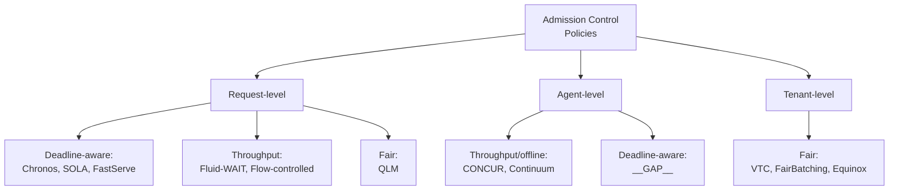

# Taxonomy — Admission Control for LLM Serving

Working draft. Four axes.

## Axis 1: Unit of admission

| Value | Description | Example policies |
|---|---|---|
| Request | Each incoming inference request is admitted/rejected individually | QLM, Chronos, FastServe, SOLA |
| Agent-session | Multi-turn agent sessions are the atomic admission unit | CONCUR/PACE, Continuum, ThunderAgent |
| Tenant | Admission decisions at the per-user or per-org level | VTC, FairBatching (partial) |

## Axis 2: Setting

| Value | Description | Example policies |
|---|---|---|
| Online serving | Interactive latency-sensitive workloads | QLM, Chronos, SOLA, FastServe |
| Offline batch | Throughput-oriented batch inference; SLOs relaxed | CONCUR/PACE, Continuum |
| Hybrid | Mix of interactive + batch | HyGen, Aegaeon |

## Axis 3: SLO awareness

| Value | Description | Example policies |
|---|---|---|
| Deadline-aware | Admission decisions consider TTFT / TBT deadlines | Chronos, SOLA, FastServe |
| Throughput-oriented | Maximize aggregate goodput without per-request deadlines | CONCUR/PACE, Continuum |
| Fairness-oriented | Enforce fairness across tenants/agents | VTC, FairBatching, Equinox |
| Cost-oriented | Minimize $/token or energy | EconoServe, CEDAR |

### Axis 3 sub-branch: SLO granularity

Added 2026-09-10 (Day 3 eval — SLOs-Serve deep read).

| Granularity | Description | Example policies |
|---|---|---|
| Job-level | Single SLO per multi-turn agent job (e.g., end-to-end completion time) | Continuum (JCT) |
| Request-level | One SLO per prompt/response request | QLM, Chronos, SOLA, FastServe (most of the field) |
| Per-stage | Distinct SLOs for each stage of a multi-turn app (e.g., ToolLLM: tight TTFT on tool-call prefill, loose TPOT on reasoning decode, tight TPOT on final answer) | **SLOs-Serve** (sole entry) |

**Observation**: per-stage SLOs are a genuine taxonomy gap — nobody else in the cluster models them. Load-bearing for a new open problem (see `open-problems.md` #17).

## Axis 4: Signal used

Refined 2026-09-10 (Day 2 eval) into 4 sub-branches capturing the *structure* of the signal, not just its content.

### Sub-branch 4a: Scalar heuristic
Single scalar compared to a threshold.

| Signal | Description | Example policies |
|---|---|---|
| KV pressure (scalar) | Aggregate cache usage as one number | Fluid-WAIT |
| Queue depth | Waiting queue length | (QLM uses this + more) |
| Estimated output length | Predicted decode duration | Clairvoyant, FastServe |
| Historical latency | Recent p95/p99 latency | (part of SOLA composite) |
| Deadline slack | Time until SLO violation | (part of Chronos) |

### Sub-branch 4b: Dual-gate conjunction
Multiple signals ANDed to distinguish healthy-high-utilization from congested-high-utilization.

| Signal combination | Rationale | Example policies |
|---|---|---|
| `U_t > U_high` AND `H_t < H_thresh` (KV util AND hit-rate collapse) | High utilization with high hit-rate is healthy reuse, not thrashing | **CONCUR** (α=2, β=0.5, U_low=0.2, U_high=0.5, H_thresh=0.2) |

### Sub-branch 4c: LP-based composite
Multi-variable linear program deciding admission jointly with scheduling/routing.

| Approach | Example policies |
|---|---|
| LP minimizing SLO-violation penalty over virtual queues | **QLM** (5s solve at 400K requests, Gurobi) |
| LP over per-iteration state (5+ state vars: request state + systemic state) | **SOLA** (α-percentile constraint relaxation = implicit admission) |
| DP over token allocations | **SLOs-Serve** |

### Sub-branch 4d: Formal WCRT / capacity bound
Closed-form worst-case-response-time bound + admission test derived from real-time-systems theory.

| Approach | Example policies |
|---|---|
| Sporadic-task WCRT (Liu-Layland lineage) + prefill utilization ρP<1 + TBT capacity theorem | **Chronos** (Theorem 1 + Algorithm 1 + Theorem 3) |
| Rate-limit derivation from stability proofs | Flow-controlled scheduling (arXiv:2604.11001) |
| Dynamical-system stability analysis (heterogeneity as stabilizer) | Service-Induced Congestion (arXiv:2606.15555) |

## Cross-axis observations

- **Nobody sits in all four intersections**: no policy is simultaneously agent-level + online + SLO-aware + fair.
- **Most crowded corner**: request-level + online + deadline-aware (QLM, Chronos, SOLA all here).
- **Least populated corner**: agent-level + online + fair — a genuine gap (see open-problems.md).

## Mermaid taxonomy diagram (draft — for paper Figure 2)

The `__GAP__` in agent-level + deadline-aware is exactly what CONCUR Reviewer Afcg pointed at.
